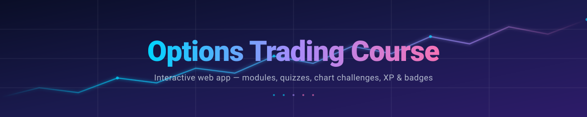

<div align="center">



<br />

<a href="https://readme-typing-svg.demolab.com">
  
</a>

<br /><br />

<p>
  <a href="https://github.com/Waleee7/options-trading-course/stargazers">
    
  </a>
  <a href="https://github.com/Waleee7/options-trading-course/network/members">
    
  </a>
  <a href="https://github.com/Waleee7/options-trading-course/issues">
    
  </a>
  <a href="https://github.com/Waleee7/options-trading-course/blob/main/LICENSE">
    
  </a>
</p>

<p>
  
  
  
  
  
</p>

</div>

---

## About

**Options Trading Course** is an interactive, gamified web app that teaches options trading from the ground up. It's designed for a wide audience — accessible enough for a curious 13-year-old, but never dumbed down for adults learning their first greek.

You don't just read about options. You progress through structured modules, take a mini-quiz at the end of each one, then test your skills on real-chart challenges (AAPL, QQQ, SPY, TSLA). Along the way you earn XP, unlock badges, level up — every concept reinforced before moving to the next.

> Built as a learning tool for family and friends. Open-sourced because the best way to learn options is by *doing* — and the best way to remember is by teaching.


---

## Features

| | |
|---|---|
| **Structured curriculum** | 13 progressive modules covering fundamentals → mechanics → the greeks → strategy |
| **Mini-quizzes** | 3-4 question quiz after every module to lock in the concept before you move on |
| **Chart challenges** | 4 real-chart scenarios (AAPL / QQQ / SPY / TSLA) — call or put, mark your entry, spot the reversal |
| **Glossary** | Searchable in-app reference for every term introduced in the course |
| **Gamified progression** | XP rewards, level-ups, badge unlocks, persistent progress, stats panel |
| **Polished motion design** | Framer Motion page transitions, XP popups, cursor trail, news ticker, floating elements |
| **Light & dark themes** | Smooth animated theme toggle with system preference detection |
| **Local-first progress** | Your progress saves to local storage — no account, no sign-up, no friction |


---

## Curriculum

<table>
<tr><th>Track</th><th>Modules</th></tr>
<tr>
  <td><b>Fundamentals</b></td>
  <td>What Is the Stock Market? · What Are Options?</td>
</tr>
<tr>
  <td><b>Core Mechanics</b></td>
  <td>Call Options Deep Dive · Put Options Deep Dive · Reading an Options Chain</td>
</tr>
<tr>
  <td><b>The Greeks</b></td>
  <td>Theta (Time Decay) · Delta (Directional Exposure) · Gamma (The Accelerator) · Vega (Volatility's Impact)</td>
</tr>
<tr>
  <td><b>Strategy</b></td>
  <td>Support &amp; Resistance Levels · Picking the Right Contracts · Common Beginner Mistakes · Intro to Spreads</td>
</tr>
<tr>
  <td><b>Chart Challenges</b></td>
  <td>Call or Put? (QQQ) · Spot the Level (SPY) · Earnings Play (AAPL) · The Reversal (TSLA)</td>
</tr>
</table>


---

## Tech Stack

<div align="center">


</div>

| Layer | Choice | Why |
|---|---|---|
| Framework | **Next.js 16** (App Router, Turbopack) | Server-first React, file-based routing, blazing dev loop |
| Language | **TypeScript 5** | Catches a class of bugs before the user ever sees them |
| UI | **React 19** | Latest concurrent features, Suspense, transitions |
| Styling | **Tailwind CSS 4** | Utility-first, zero-runtime, design-system-friendly |
| Motion | **Framer Motion 12** | Page transitions, XP popups, micro-interactions |
| Icons | **Lucide React** | Crisp, consistent, tree-shakeable iconography |
| Deploy | **Vercel** | Push-to-deploy, edge network, zero-config for Next.js |


---

## Preview

> Screenshots coming soon. The app features a trading-themed animated background, theme-aware UI, and motion-rich interactions throughout.

<!-- Drop screenshots here once you have them:
<p align="center">
  
  
</p>
-->


---

## Getting Started

**Prerequisites:** Node.js 20+ and npm.

```bash
# 1. Clone
git clone https://github.com/Waleee7/options-trading-course.git
cd options-trading-course

# 2. Install dependencies
npm install

# 3. Run the dev server
npm run dev
```

Open [http://localhost:3000](http://localhost:3000) in your browser.

### Available scripts

| Script | What it does |
|---|---|
| `npm run dev` | Start the Next.js dev server with Turbopack |
| `npm run build` | Production build |
| `npm run start` | Run the production build locally |
| `npm run lint` | Lint the codebase with ESLint |


---

## Project Structure

```
options-trading-course/
├── public/                       # Static assets (chart images, backgrounds)
├── src/
│   ├── app/                      # Next.js App Router routes
│   │   ├── page.tsx              # Landing / dashboard
│   │   ├── course/               # Module pages
│   │   ├── quiz/                 # Quiz pages
│   │   ├── challenge/            # Chart challenge pages
│   │   ├── glossary/             # Searchable glossary
│   │   ├── complete/             # Completion / certificate screen
│   │   ├── layout.tsx            # Root layout, providers
│   │   └── globals.css           # Tailwind base styles
│   ├── components/               # Reusable UI
│   │   ├── ModuleCard.tsx
│   │   ├── ProgressBar.tsx
│   │   ├── BadgesPanel.tsx
│   │   ├── StatsPanel.tsx
│   │   ├── XpPopup.tsx
│   │   ├── ThemeToggle.tsx
│   │   ├── TradingBackground.tsx
│   │   ├── CursorTrail.tsx
│   │   ├── FloatingElements.tsx
│   │   ├── NewsTicker.tsx
│   │   └── ClientProviders.tsx
│   ├── data/
│   │   ├── modules.ts            # Course content (modules, quizzes, tips)
│   │   └── glossary.ts           # Glossary terms
│   ├── lib/
│   │   ├── progress.ts           # XP, badges, persistence
│   │   ├── theme.tsx             # Theme provider
│   │   └── types.ts              # Shared type definitions
│   └── hooks/                    # Custom React hooks
├── next.config.ts
├── tsconfig.json
└── package.json
```


---

## Roadmap

- [x] Core curriculum (13 modules) with quizzes
- [x] Chart challenge mode (4 scenarios)
- [x] XP, badges, persistent progress
- [x] Light / dark theme
- [ ] Glossary tooltips inline within modules
- [ ] Strategy simulator — payoff diagrams for spreads, straddles, condors
- [ ] Greeks playground — interactive sliders for delta / theta / vega
- [ ] Real-time chart embed for live practice
- [ ] Multi-user leaderboards
- [ ] Audio walkthroughs per module


---

## Disclaimer

This project is for **educational purposes only**. Nothing in this app is financial advice. Options trading involves substantial risk of loss and is not suitable for all investors. Always consult a licensed financial advisor before making real trades.


---

## License

Released under the [MIT License](LICENSE) — free to use, modify, and share.

<br />

<div align="center">


<sub>Built with care for the next generation of curious traders.</sub>

</div>
