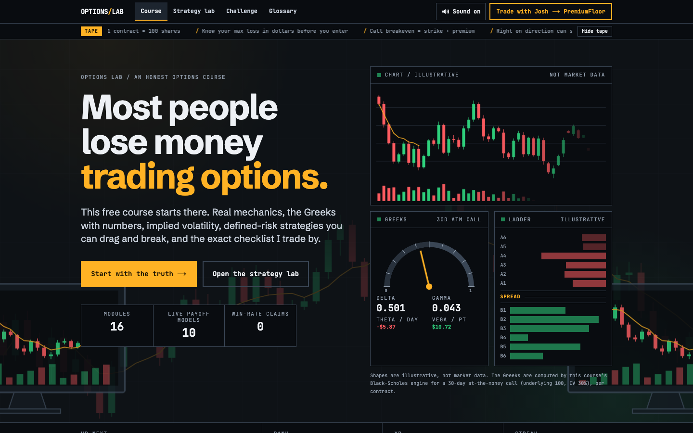
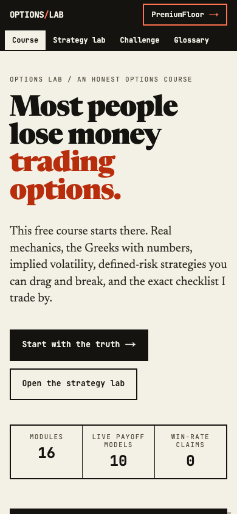
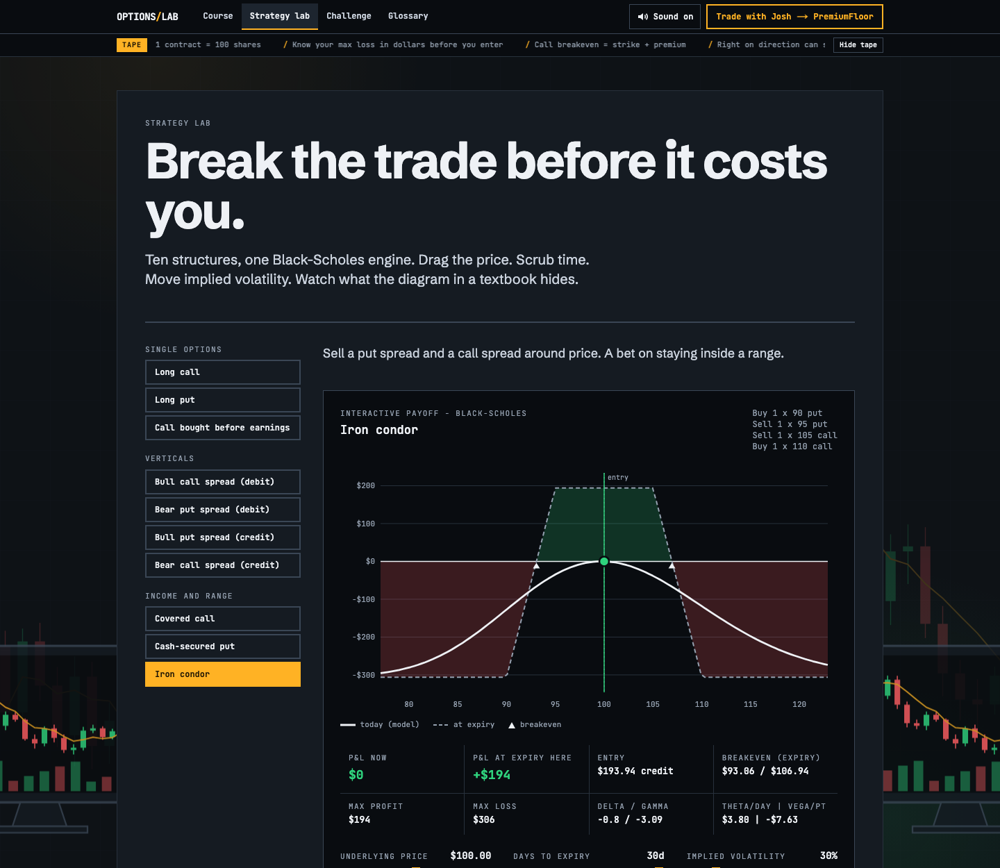
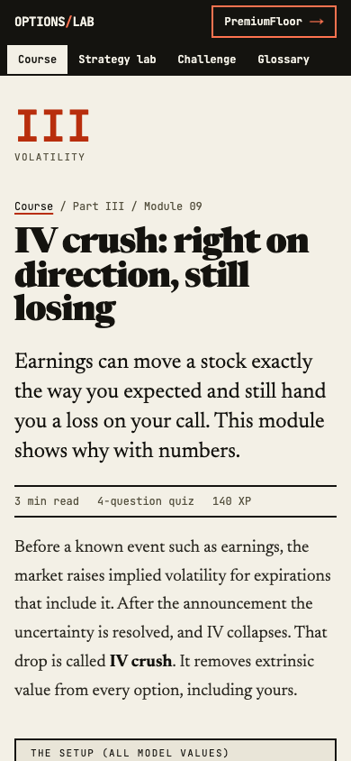

<p align="center"></p>

<p align="center">
  <a href="https://optionstradingcourse.vercel.app"></a>
  
  
  
</p>

## In 20 seconds

**Options Lab is a free options course that opens with the truth: most people who trade options lose money.**
Then it teaches you how options are priced, how to define your risk before you enter, and how to size so being wrong is survivable. Sixteen short modules, ten interactive payoff charts you can drag and break, a challenge mode scored by the pricing engine, and the exact checklist the author trades by.

**Live:** https://optionstradingcourse.vercel.app

<table>
  <tr>
    <td></td>
    <td width="240"></td>
  </tr>
  <tr>
    <td></td>
    <td width="240"></td>
  </tr>
</table>

## What you will learn

| Part | Modules |
|---|---|
| **00 The truth** | What the evidence says about people who trade options, and why options are unforgiving |
| **I Mechanics** | Calls and puts, the 100x multiplier, intrinsic vs extrinsic value, moneyness, breakevens with worked examples, exercise and assignment, American vs European, bid/ask spread and liquidity |
| **II The Greeks** | Delta and gamma, theta and vega with numbers, gamma risk into expiry and 0DTE realities |
| **III Volatility** | Implied vs realized volatility, IV rank vs IV percentile, expected move, IV crush (why a correct call into earnings can still lose) |
| **IV Defined-risk strategies** | Vertical spreads (debit and credit), covered calls, cash-secured puts, iron condors, each with an interactive payoff chart |
| **V Risk and mind** | Position sizing and drawdown arithmetic, trade plans, journaling, revenge trading and overtrading |
| **VI How I actually trade** | The scoring, firewall, and exit rules from my own options decision engine, presented as a process and not as a track record |

Also: a **strategy lab** with ten structures, a **challenge** of seven predict-then-check scenarios, a linked **glossary**, and light gamification (XP, ranks, marks) that stays out of the way. Progress lives only in your browser.

## The honesty principle

- The only statistics on the site are two, cited with links: the [SEBI study](https://www.sebi.gov.in/media-and-notifications/press-releases/sep-2024/updated-sebi-study-reveals-93-of-individual-traders-incurred-losses-in-equity-fando-between-fy22-and-fy24-aggregate-losses-exceed-1-8-lakh-crores-over-three-years_86906.html) (93% of over 10 million individual equity F&O traders in India lost money, FY22 to FY24) and the [Chague, De-Losso & Giovannetti paper](https://papers.ssrn.com/sol3/papers.cfm?abstract_id=3423101) (97% of Brazilian mini-index futures day traders who persisted over 300 days lost money).
- No win rates, returns, follower counts, or testimonials. Ever.
- Every number in a worked example comes from the same unit-tested Black-Scholes engine that draws the charts. The challenge answers are checked against that engine in the test suite, so prose and math cannot drift apart.
- A **Receipts** section exists for real, dated screenshots. It renders only when `src/data/receipts.ts` has entries, and it ships empty.
- The "How I actually trade" module states plainly that the engine runs in paper and demo mode, and that nothing in it is evidence of a profitable edge.

> **Disclaimer.** Educational only. Not financial advice. Most traders lose money. Past results do not guarantee future results. Options are leveraged and you can lose your entire premium or more. Pricing models are simplifications; real fills, spreads, taxes, and fees will differ.

## PremiumFloor

I run **PremiumFloor**, where I share market analysis, options setups, education, and coaching built on the same process: **[Trade with Josh on PremiumFloor](https://whop.com/premiumfloor)**. It is optional, the course is complete without it, and there are no guarantees: most traders lose money.

## Quick start

```bash
git clone https://github.com/Waleee7/options-trading-course.git
cd options-trading-course
npm install
npm run dev                         # http://localhost:3000

# production build, served on port 7312
npm run build && npx next start -p 7312   # same as: npm run serve
```

Checks:

```bash
npm test            # Vitest: Black-Scholes, Greeks, strategy payoffs, content integrity
npm run test:e2e    # Browser tests on Chromium, WebKit and Firefox (run npm run build first)
npm run lint
npm run typecheck
npm run build
```

## Under the hood

- **Pricing engine** (`src/lib/options/blackScholes.ts`): Black-Scholes-Merton price, delta, gamma, theta, vega, rho, implied volatility by bisection, expected move. The normal CDF is Hart's double-precision algorithm. Tests check textbook values (including Hull's worked example), put-call parity across a grid, and every analytic Greek against finite differences.
- **Strategy engine** (`src/lib/options/strategies.ts`): multi-leg positions, exact max profit, max loss, and breakevens (the expiry payoff is piecewise linear, so they are solved, not sampled), and ten presets used by both the prose and the charts.
- **Interactive SVG charts** (`src/components/charts/`): hand-built, no chart library. Drag the handle or use arrow keys; sliders for price, days to expiry, and implied volatility. Model limits are stated on screen: flat IV, 4% rate, no dividends, theoretical mid prices, no fees.
- **Content as data** (`src/data/`): modules, glossary, challenge scenarios, receipts. A test suite checks quiz structure, glossary links, the PremiumFloor placements, and guards against hype language.
- **The desk (visual identity)**: a graphite trading-desk workspace. Visible, abstract chart panels are design elements: candlesticks with volume, an order-book-style ladder, and a Greeks gauge. They are labelled illustrative, the shapes are seeded, and the only numbers on them are Greeks computed by the course's own engine. Lessons sit on lighter, high-contrast reading panels. Green and red mean P&L and direction only; one amber accent carries the brand and calls to action. Schibsted Grotesk for text, JetBrains Mono for numbers.
- **Motion**: charts draw in, candles tick, numbers count up, progress bars fill. CSS and SVG only, no canvas loops, and all of it stops under `prefers-reduced-motion`.
- **Feedback**: soft haptics (`navigator.vibrate`) and very quiet WebAudio ticks on answer select, correct and wrong, XP gain, and module complete. One mute toggle in the header, remembered in `localStorage`.
- **Learner path**: a "Continue" button and an Up next strip that always point at the first unfinished lesson, a 16-step path bar on every lesson, a scroll-linked reading bar, and a quiz after each module. An optional "course tape" carries course reminders only, with no prices.

## Tech stack

Next.js 16 (App Router, static generation), React 19, TypeScript (strict), Tailwind CSS 4, Vitest. No runtime chart, animation, or icon libraries.

## Credit

Built by [Akinwale Dare](https://josh-dare.vercel.app).

Licensed under the terms in [LICENSE](LICENSE).
